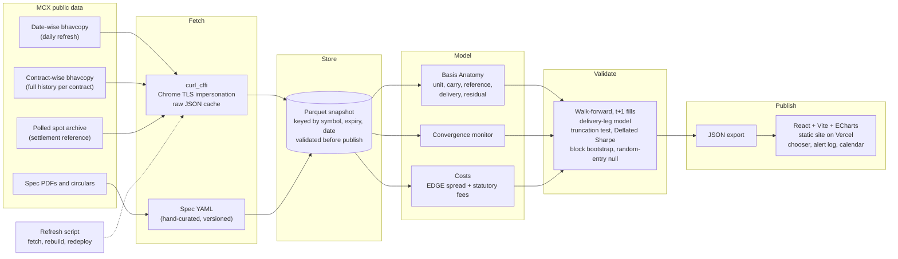

# Tola: the fair-price desk for MCX gold

> One gram of gold, five different prices. Tola explains why.

MCX lists gold futures in several sizes: GOLD, GOLDM, GOLDTEN, GOLDGUINEA and GOLDPETAL. After normalising for unit and purity, a gram of gold should cost about the same in each of them. It doesn't.

Tola breaks every price gap into the parts that are fair and the part that isn't explained. It measures each contract against **the exchange's own polled spot price it settles to**. It then tests whether the leftover gap survives *measured* trading costs. Finally, it turns the result into a decision a trader can act on: which contract to hold, for how long, and whether to take delivery.

Built by team **Numero Uno** for **Hack in Hills '26, PS03: Commodity Derivatives Intelligence**.

**Live:** [tola-gold.vercel.app](https://tola-gold.vercel.app) (MCX data to 27 Oct 2026)

| Round 2 submission | |
|---|---|
| Elevator pitch video | [Round2/Tola_ElevatorPitch.mp4](Round2/Tola_ElevatorPitch.mp4) |
| Working prototype demo | [Round2/Tola_Prototype_Demo.mp4](Round2/Tola_Prototype_Demo.mp4) |
| Deck | [Round2/Tola_PS03_Round2_NumeroUno.pptx](Round2/Tola_PS03_Round2_NumeroUno.pptx) |

---

## Key finding

Across all **18 same-expiry cycles from Apr 2025 to Sep 2026**, the small contracts traded rich to GOLDTEN even though all three settle to the same price per gram:

| Premium over GOLDTEN (per gram) | Cycles positive | Mean, VWAP | 95% CI (cycle bootstrap) |
|---|---|---|---|
| GOLDGUINEA (8 g) | 18 / 18 | **+78.7 bp** | [61, 97] |
| GOLDPETAL (1 g) | 18 / 18 | **+94.1 bp** | [80, 109] |

Why this result holds up:
- **Pre-registered.** The test rule was written down before the data was pulled ([G0_PREREGISTRATION.md](PS%20Research/g0_gate/G0_PREREGISTRATION.md)).
- **Four price marks.** The premium survives Close, Open, (H+L)/2 and VWAP. That rules out a closing-time artefact.
- **Robust.** It holds under every sensitivity run: liquidity floors, delivery-window length, and excluding the Jan 2026 crash.
- **Same settlement target, verified.** GOLDTEN and GOLDGUINEA settle to the identical price per gram in **18/18 cycles** (≤ 0.11 bp), and the 999/995 purity factor is applied in every spec version. GOLDPETAL settles against Mumbai spot, a median 3.8 bp *below* GOLDTEN, so its own premium is slightly larger.

How it behaves:
- It does **not** decay before delivery.
- Only final settlement removes it.
- It varies over time: cycle means ranged from 34 to 145 bp, peaking in the Mar–Jun 2026 cycles.

Who pays it:
- **Traders who exit before the delivery window** give up only the change in the premium, about 6–11 bp (≈ ₹9–16/g). Brokers force most retail traders out before then anyway.
- **Delivery takers** pay all of it. Even so, at 13 Oct 2026 prices GOLDPETAL delivery (≈ ₹15,450/g including the premium, ₹100/g making charge and GST) was still about **₹610/g cheaper than a retail 1 g coin** (₹16,060). So the premium looks like the market price of small-denomination physical gold, not a rip-off.
- **Size:** over the last 12 cycles, about **₹10.3 Cr** of premium sat on GOLDGUINEA and GOLDPETAL positions entering the delivery window. Our pipeline computes this from open interest, premium and settlement price.

Full write-up: [G0_RESULTS.md](PS%20Research/g0_gate/G0_RESULTS.md).

What the Round 2 build added on top of G0 (each milestone has its own write-up):
- **Where the premium comes from** ([M2](PS%20Research/m2_basis/M2_RESULTS.md)): every price split into timing, carry, settlement reference and premium. Carry peaked near 17% a year in Jan 2026 against T-bills near 5.3%.
- **How it behaves** ([M3](PS%20Research/m3_convergence/M3_RESULTS.md)): present in every cycle, removed in one step at settlement.
- **Who can collect it** ([M4](PS%20Research/m4_verdict/M4_RESULTS.md)): to profit from delivery you would need coins under 0.27% (8 g) or 1.13% (1 g) over spot; the cheapest retail coins are 3.6% and 5.5%, so it paid in 0 of 18 cycles. Trading the premium's swings earned a small edge, mostly in Jan–Mar 2026. A forward test is pre-registered for the finale ([FORWARD_TEST_PREREGISTRATION.md](PS%20Research/m4_verdict/FORWARD_TEST_PREREGISTRATION.md)).
- **What to do about it** ([M5](PS%20Research/m5_chooser/M5_CHOOSER.md)): the chooser, the quiet notice log and the contract calendar.

---

## What Tola does

1. **Basis Anatomy.** For each contract and day, a waterfall from the raw price to the residual, in five steps:
   - **Unit:** price per fine gram, using the dated contract spec.
   - **Carry:** the expiry gap (~5th of the month vs month-end), implied from each contract's own curve.
   - **Settlement reference:** Ahmedabad vs Mumbai polled spot, single poll vs 3-day average.
   - **Delivery terms:** bar vs coin, tender window and margin, making charge.
   - **Residual:** the small-lot premium.
2. **Convergence monitor.** Tracks GOLDTEN, GOLDGUINEA and GOLDPETAL, which share one settlement price. GOLD vs GOLDM serves as a control pair on the near even-month expiry (GOLD lists only Feb, Apr, Jun, Aug, Oct and Dec).
3. **Walk-forward verdict.**
   - No look-ahead; fills at t+1.
   - Costs come from an OHLC spread estimator (EDGE) plus Indian statutory charges.
   - It models **the delivery leg explicitly**: short the small contract into settlement and deliver coins, the only trade that captures the premium.
   - P&L is split into a gold-price leg and a spread leg.
   - Validation uses a random-entry null, a block bootstrap and the Deflated Sharpe ratio.
4. **"Which contract?" chooser.** Input grams, holding period, broker and whether you'll take delivery. Output is a ranked effective cost, with tender and broker exit deadlines. The broker is a parameter; the default preset is Zerodha rates (0.03% or ₹20 per order).
5. **Quiet alert log.** It records signals only when the residual clears the measured cost hurdle, and logs why every other day was quiet.

Tola analyses public data. It does **not** place trades and is **not investment advice**.

---

## Data

All data is free and public, from MCX:

| Dataset | Endpoint |
|---|---|
| Daily bhavcopy, all contracts | `/market-data/bhavcopy/GetDateWiseBhavCopy` |
| Full history per contract | `/market-data/bhavcopy/GetCommoditywiseBhavCopy` |
| Polled spot (settlement reference) | `/GetSpotMarketArchive` |
| Contract specifications | Versioned spec PDFs from the MCX gold product page |

Gotchas this repo handles:
- **Akamai blocks plain HTTP clients** (HTTP 403). The fetcher uses `curl_cffi` with Chrome TLS impersonation. The `POST /backpage.aspx` endpoints that older libraries use are dead.
- **Formats differ.** Request dates are DD/MM/YYYY, response dates are MM/DD/YYYY, and symbols are space-padded.
- **Holidays** return empty data. The returned date is still checked against the requested one, because the PS warns some dates may return the previous trading day.
- **No-trade days** come back as zero OHLC with the Close carried forward. These are never used as fills.
- **`Value` is turnover in ₹ lakh.** Daily VWAP per gram = Value × 10⁵ ÷ (Volume × grams per lot).
- **Positions are keyed by `(symbol, expiry)`**, never by a continuous series.
- **Contract specs change between versions:** the tender window went from 5 to 3 days and the tender margin from 5% to 8.34%.

Raw MCX responses are cached in `data/raw/` (not in git; their hashes are in `data/snapshot/raw_index.json`). The validated snapshot in `data/snapshot/` is committed, so everything rebuilds offline. Please fetch politely: one session and at least 1.5 s between calls. Details: [data/README.md](data/README.md).

---

## Architecture



**Stack:** Python 3.12 · curl_cffi · pandas · pyarrow · SciPy · bidask · PyYAML · pytest · React 19 · Vite · ECharts · Hairline (landing figures) · Vitest

---

## Quick start

### Reproduce the G0 result (works today)

```bash
pip install curl_cffi pandas numpy
cd "PS Research/g0_gate"

python analyze_g0.py         # premium gate, offline from the cached raw/ data
python settlement_check.py   # shared-settlement check, offline from raw/spot/

python fetch_g0.py           # optional: refresh from MCX (only fetches what isn't cached)
```

Results are written to `PS Research/g0_gate/results/`.

### Run the app

```bash
git clone https://github.com/Mrigank005/Tola.git
cd Tola
python -m venv .venv && source .venv/bin/activate   # Windows: .venv\Scripts\activate
pip install -r requirements.txt

python -m pytest -q               # 45 tests, including the look-ahead truncation test
python -m tola.refresh --offline  # optional: rebuild data/snapshot and data/export from the local cache
python -m tola.refresh            # optional: fetch the latest MCX days first (run from India; MCX blocks most cloud IPs)

cd web && npm install && npm run dev   # http://localhost:5173
```

The committed snapshot already holds MCX data to 27 Oct 2026, so the app runs without fetching anything. Web app details and deploy steps: [web/README.md](web/README.md).

---

## Repository layout

```
tola/              fetcher, parser, specs, snapshot build, basis anatomy, convergence,
                   walk-forward backtest, delivery economics, chooser, alerts, JSON export
tests/             pytest suite (parser, specs, snapshot, anatomy, convergence, backtest, chooser)
data/specs/        versioned contract specs, costs and rates (YAML, each value cites its source)
data/raw/specs/    the 15 MCX spec PDFs behind data/specs/gold.yaml
data/snapshot/     committed Parquet snapshot, manifest and VALIDATION.md
data/export/       JSON the web app reads at build time
web/               React + Vite static site (landing, chooser, rates, evidence pages, notices, method)
PS Research/       research notes, G0 gate, and the M2 to M5 write-ups
Design/            gold-terminal design system (palette and components)
DESIGN.md          web app design decisions; PRODUCT.md the product brief
Round1/            Round 1 pitch deck
Round2/            Round 2 deck, elevator pitch video and prototype demo video
```

---

## Status

- [x] Research and scope
- [x] G0 premium gate (GO on both pairs)
- [x] 18-cycle settlement-reference check (passed)
- [x] Round 1 pitch deck
- [x] M1 data layer: fetcher, versioned specs, validated snapshot
- [x] M2 basis anatomy and M3 convergence monitor
- [x] M4 walk-forward verdict with measured costs and the delivery leg
- [x] M5 chooser, quiet notice log and contract calendar
- [x] Web app: landing page, chooser, rate board, evidence pages, notices, method
- [ ] Finale (20 Nov): forward test results, daily refresh, silver extension, spec-change annotator

## Team: Numero Uno

| Name | Role |
|---|---|
| Mrigank Singh | Data and quant: fetcher, specs, decomposition, validation |
| Lakshita Deopura | Product and pitch: UI, chooser, research, deck |

## License

Code is licensed under the [Apache License 2.0](LICENSE). Copyright 2026 Numero Uno (Mrigank Singh, Lakshita Deopura).

Market data © Multi Commodity Exchange of India Ltd. It is not covered by this license and is used for non-commercial research only.
